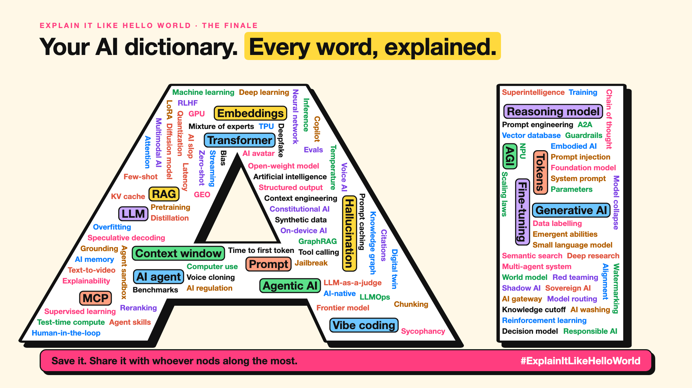

# 118. Your AI Dictionary, One Line per Word | The Finale



*Explain It Like Hello World series: the finale*

Remember the meeting from the curtain raiser? "We'll use a quantized mixture-of-experts model with a bigger context window."

Now you can explain every word in it. Quantized: the same photo saved as a smaller file. Mixture of experts: a hospital where you only see the specialists you need. Context window: the AI's desk.

That was the whole idea of this series: every AI word has a hello world, a tiny example that makes it click. Here are all 116, one line each.

## Your AI dictionary

**The basics**

- **Artificial intelligence** (2): Artificial intelligence (AI) is a computer doing something we'd say needs human intelligence.
- **Machine learning** (3): Machine learning learns the patterns from examples instead.
- **Deep learning** (4): Deep learning learns in layers, just like that.
- **Neural network** (5): A neural network is billions of tiny voters adding up numbers.
- **Generative AI** (6): Generative AI makes new things instead of just labelling old ones.
- **Foundation model** (7): A foundation model is one big base that many AI products are built on.
- **Frontier model** (8): A frontier model is AI at that edge: the most capable models right now.
- **AGI** (9): AGI means one AI that can learn most tasks a person can.
- **Superintelligence** (10): Superintelligence means AI smarter than the best humans in almost every field.

**How an AI reads and writes**

- **Tokens** (11): An AI doesn't read words. It reads pieces, called tokens.
- **LLM** (12): An LLM writes by guessing the next word, again and again.
- **Embeddings** (13): An embedding is a word's address on a map of meaning.
- **Attention** (14): You glanced back at the other words. So does an AI. That's attention.
- **Transformer** (15): A transformer lays the whole sentence out and reads it all at once.
- **Context window** (16): An AI's context window is its desk. When it's full, something falls off.
- **Knowledge cutoff** (17): That's a knowledge cutoff: the date an AI stops knowing things on its own.
- **Temperature** (18): Temperature is how adventurous the AI's next word is.

**Talking to an AI**

- **Prompt** (19): A prompt is your brief to the AI. Vague brief, vague answer.
- **Prompt engineering** (20): Prompt engineering is the second person.
- **System prompt** (21): A system prompt is that briefing, given to the AI before you type.
- **Zero-shot** (22): The AI answers "negative" anyway. That's zero-shot.
- **Few-shot** (23): The AI answers GRN-TRS. That's few-shot: show a few examples, it copies the pattern.
- **Chain of thought** (24): Writing the steps first helps an AI too. That's chain of thought.
- **Context engineering** (25): Context engineering is choosing what goes on the AI's desk.
- **Structured output** (26): Structured output makes the AI fill in boxes instead of writing paragraphs.
- **Streaming** (27): Streaming serves each word of the answer as soon as it's ready.

**How an AI is made**

- **Parameters** (28): 70B means 70 billion parameters: tiny knobs, each tuned during training.
- **Training** (29): Training is an AI doing that billions of times.
- **Supervised learning** (30): That's supervised versus unsupervised learning: with answers, or without.
- **Inference** (31): That's inference: a frozen model answering. It isn't learning mid-exam.
- **Pretraining** (32): Pretraining is the AI's general schooling, before any specialist course.
- **Fine-tuning** (33): Fine-tuning teaches a general AI your menu.
- **LoRA** (34): LoRA is that recipe card: a small, swappable add-on to an AI.
- **Reinforcement learning** (35): Reinforcement learning is AI learning by trial, error and reward.
- **RLHF** (36): Thumbs up, thumbs down, thousands of times. That's how AIs learned to answer.
- **Constitutional AI** (37): Constitutional AI teaches a model to check its own answers against written principles.
- **Distillation** (38): What if the big one taught the small one? That's distillation.
- **Synthetic data** (39): So an AI writes them, and another AI learns from them. That's synthetic data.
- **Data labelling** (40): Data labelling: people marking the right answers so AI can learn.
- **Overfitting** (41): That's overfitting: memorising examples instead of learning the pattern.
- **Scaling laws** (42): AI improved the same way. Researchers call it scaling laws.
- **Emergent abilities** (43): Emergent abilities: skills that seem to appear once an AI is big enough.
- **Model collapse** (44): Model collapse is AI learning from AI, and fading the same way.

**Smaller, faster, cheaper**

- **Quantization** (45): Quantization is saving the same photo as a smaller file.
- **Mixture of experts** (46): A mixture of experts sends each word to only a few specialists.
- **KV cache** (47): Neither does an AI. It keeps notes, called the KV cache.
- **Prompt caching** (48): Prompt caching reads it once and reuses the notes.
- **Speculative decoding** (49): That's speculative decoding: guess ahead, check in one go.
- **Test-time compute** (50): Test-time compute lets an AI use the scrap paper.
- **GPU** (51): AI picks the students. That's why it runs on GPUs.
- **TPU** (52): A TPU is Google's bread knife for AI maths.
- **NPU** (53): That's the NPU: low-power AI, right on your device.
- **Small language model** (54): A small language model is the pocket dictionary.
- **On-device AI** (55): That's on-device AI: answers without the call.
- **Latency** (56): That wait is latency: every step between asking and answering.
- **Time to first token** (57): Time to first token is the AI's bread basket.

**Giving AI knowledge**

- **RAG** (58): RAG is an AI doing an open-book exam on your documents.
- **Chunking** (59): Chunking cuts documents into labelled pieces, so AI reads only what matters.
- **Vector database** (60): A vector database is a filing cabinet sorted by meaning.
- **Semantic search** (61): Semantic search finds results by meaning, not just matching words.
- **Reranking** (62): Reranking is that careful second look, for AI search results.
- **Knowledge graph** (63): A knowledge graph stores facts as things and the links between them.
- **GraphRAG** (64): GraphRAG maps everything first, then answers from the map.
- **Grounding** (65): Grounding makes the AI the second student.
- **Citations** (66): Citations give every AI answer a receipt.
- **Deep research** (67): Deep research is an AI doing that whole loop on its own.

**AI that acts**

- **AI agent** (68): A chatbot is the librarian. An AI agent is the assistant who gets it done.
- **Agentic AI** (69): Agentic is how far along that scale an AI system sits.
- **Tool calling** (70): So it asks your app to run a weather tool. That's tool calling.
- **MCP** (71): MCP is that one plug, between AI apps and tools.
- **Agent skills** (72): Agent skills are that binder, for an AI agent.
- **A2A** (73): A2A is how AI agents swap business cards and hand over tasks.
- **Multi-agent system** (74): A multi-agent system is that team, made of AI agents.
- **AI memory** (75): AI memory is that guest file, read back at the start of each chat.
- **Computer use** (76): Look, decide, click, look again. That's computer use.
- **Copilot** (77): An AI copilot suggests. You decide. An agent acts.
- **Agent sandbox** (78): An agent sandbox is that tray, for AI agents running code.

**New kinds of AI**

- **Reasoning model** (79): Most people blurt ₹10. Thinking step by step gets ₹5. Reasoning models do the same.
- **Decision model** (80): A decision model does the same: it compares options and picks one.
- **Multimodal AI** (81): One AI that reads, sees and listens. That's multimodal.
- **Diffusion model** (82): Now run it backwards. That's how a diffusion model draws.
- **Voice AI** (83): New voice AI hears, thinks and speaks in one breath.
- **Text-to-video** (84): Text-to-video AI draws that flipbook from a single sentence.
- **Deepfake** (85): It might not be your CFO. That's a deepfake.
- **Voice cloning** (86): Voice cloning can copy a voice from a few seconds of audio.
- **AI avatar** (87): That's an AI avatar: a presenter who was never filmed for this video.
- **Digital twin** (88): A digital twin is a live copy you can safely experiment on.
- **Open-weight model** (89): That's the difference between closed and open-weight AI models.
- **World model** (90): A world model is an AI that imagines what happens next.
- **Embodied AI** (91): Embodied AI is AI with a body, learning the hard part.

**Trust, safety and rules**

- **Hallucination** (92): An AI guesses likely words. Likely isn't always true. That's a hallucination.
- **Sycophancy** (93): That's AI sycophancy: telling you what you want to hear.
- **Guardrails** (94): AI guardrails are checks on what goes in and what comes out.
- **Human-in-the-loop** (95): Human-in-the-loop means a person checks the AI before it counts.
- **Jailbreak** (96): A jailbreak is clever wording that talks an AI out of its rules.
- **Prompt injection** (97): That's prompt injection: orders hidden in what the AI reads.
- **Red teaming** (98): Red teaming is attacking your own AI before anyone else does.
- **Evals** (99): Evals are that list, for AI.
- **LLM-as-a-judge** (100): LLM-as-a-judge: one AI marking another, with a guide.
- **Bias** (101): So the AI picks men too. That's AI bias.
- **Explainability** (102): Explainability is being able to say why, in plain words.
- **Alignment** (103): Alignment is making AI do what we mean, not just what we say.
- **Watermarking** (104): AI watermarks work the same way: invisible, until you check.
- **AI regulation** (105): AI regulation works the same way: rules by level of risk.
- **Responsible AI** (106): Responsible AI is the same idea for AI: a system, with owners.
- **Shadow AI** (107): That's shadow AI: AI use nobody approved or knows about.
- **Sovereign AI** (108): Sovereign AI is the same idea, for AI models, data and computing.

**Reading the headlines**

- **Benchmarks** (109): A benchmark is a school exam for AI. Your work is a different exam.
- **Vibe coding** (110): Describe it, test it, ask for changes. That's vibe coding.
- **AI slop** (111): That's AI slop: content made cheaply, for clicks, not for you.
- **AI washing** (112): AI washing is the same trick: AI on the label, little in the product.
- **GEO** (113): GEO is making sure that answer can find and quote you.
- **AI-native** (114): AI-native means built around AI from the start, not AI added later.
- **LLMOps** (115): LLMOps is running the AI restaurant every day.
- **AI gateway** (116): An AI gateway is that reception desk, for every AI request.
- **Model routing** (117): Model routing sends each AI question to the right-sized model.

## How to learn the next AI word

1. Find the smallest example that shows it working.
2. Add one step to get to the real thing.
3. Find it in a product you already use.
4. Only then learn the technical name.

## Take this to your next meeting

1. Save this list. Share it with whoever nods along the most.
2. When a new AI word appears, ask for its hello world.
3. Send me the words this series missed. They might start the next season.

The words sound hard. The ideas never were.

Thank you for reading, commenting and sharing along the way.

Which word finally clicked for you?

**Earlier in this series:**

1. [AI words everyone uses. Nobody explains.](https://lnkd.in/p/d8abaPhq) (the curtain raiser post)
2. [What Actually Counts as Artificial Intelligence?](https://www.linkedin.com/pulse/2-what-actually-counts-artificial-intelligence-arpit-jain-su9lf)
3. [How Does Machine Learning Learn Without Being Told the Rules?](https://www.linkedin.com/pulse/3-how-does-machine-learning-learn-without-being-told-rules-arpit-jain-ppdyf)
4. [What's "Deep" About Deep Learning?](https://www.linkedin.com/pulse/4-whats-deep-learning-arpit-jain-rvlff)
5. Is a Neural Network Really Like a Brain? *(link added when published)*
6. What Makes Generative AI "Generative"? *(link added when published)*
7. Why Are They Called Foundation Models? *(link added when published)*
8. What Is a Frontier Model, and Who Decides? *(link added when published)*
9. What Is AGI, and What Would Make AI "General"? *(link added when published)*
10. What Is Superintelligence, and Should We Worry? *(link added when published)*
11. What Are Tokens, and Why Does an AI Read in Pieces? *(link added when published)*
12. How Does an LLM Write a Sentence? *(link added when published)*
13. How Do Embeddings Know "King" Is Close to "Queen"? *(link added when published)*
14. How Does Attention Help an AI Know What "It" Means? *(link added when published)*
15. What Is a Transformer, the "T" in GPT? *(link added when published)*
16. What Is a Context Window, and Why Does an AI Forget? *(link added when published)*
17. What's a Knowledge Cutoff, and Why Is the AI Behind on News? *(link added when published)*
18. Why Does Temperature Change the AI's Answer? *(link added when published)*
19. What Is a Prompt, and Why Does the Way You Ask Matter? *(link added when published)*
20. Is Prompt Engineering a Real Skill? *(link added when published)*
21. What's in a System Prompt, the Hidden Instruction Behind Every Chatbot? *(link added when published)*
22. What Is Zero-Shot, and Can an AI Do a Task It Was Never Shown? *(link added when published)*
23. Why Does Few-Shot Prompting Work So Well? *(link added when published)*
24. Why Does Chain of Thought ("Think Step by Step") Work? *(link added when published)*
25. Is Context Engineering the New Prompt Engineering? *(link added when published)*
26. How Does Structured Output Get an AI to Fill In a Form? *(link added when published)*
27. Why Does Streaming Make the AI Type Word by Word? *(link added when published)*
28. What Do Parameters, Like "70B", Actually Mean? *(link added when published)*
29. What Happens During Training, When an AI Goes to School? *(link added when published)*
30. What's the Difference Between Supervised and Unsupervised Learning? *(link added when published)*
31. What Is Inference, and What Happens When You Hit Send? *(link added when published)*
32. What Is Pretraining, and How Does an AI Learn Language? *(link added when published)*
33. What Is Fine-Tuning, and How Does an AI Learn Your Way? *(link added when published)*
34. What Is LoRA, and How Do You Customise an AI Cheaply? *(link added when published)*
35. How Does Reinforcement Learning Teach AI by Trial and Error? *(link added when published)*
36. What Is RLHF, and How Did the AI Learn to Be Polite? *(link added when published)*
37. What Is Constitutional AI, and Can an AI Follow Principles? *(link added when published)*
38. What Is Distillation, and How Does a Small AI Learn From a Big One? *(link added when published)*
39. What Is Synthetic Data, and Can an AI Learn From AI-Written Data? *(link added when published)*
40. What Is Data Labelling, and Who Teaches the AI What's Right? *(link added when published)*
41. What Is Overfitting, and Why Can an AI Ace the Practice Test and Fail? *(link added when published)*
42. What Are Scaling Laws, and Why Did Bigger AI Keep Getting Better? *(link added when published)*
43. Are Emergent Abilities Real, or Does Bigger AI Just Seem to Learn New Tricks? *(link added when published)*
44. What Is Model Collapse, and What Happens When AI Learns From AI? *(link added when published)*
45. What Is Quantization, and How Does a Giant AI Fit on a Laptop? *(link added when published)*
46. What Is a Mixture of Experts, and Why Doesn't the Whole AI Wake Up? *(link added when published)*
47. What Is a KV Cache, and Why Doesn't the AI Re-Read Everything? *(link added when published)*
48. How Does Prompt Caching Make Repeated Prompts Cheaper? *(link added when published)*
49. How Does Speculative Decoding Make a Big AI Faster? *(link added when published)*
50. What Is Test-Time Compute, and Why Does Thinking Cost More? *(link added when published)*
51. Why Does AI Run on a GPU, a Gaming Chip? *(link added when published)*
52. What Is a TPU, and Why Did Google Build One? *(link added when published)*
53. What Is an NPU, the AI Chip Inside Your New Laptop? *(link added when published)*
54. Can a Small Language Model Be Good Enough? *(link added when published)*
55. What Is On-Device AI, and Can an AI Live on Your Phone? *(link added when published)*
56. What Is Latency, and Why Does the AI Take So Long to Answer? *(link added when published)*
57. What Is Time to First Token, and Why Does the First Word Matter Most? *(link added when published)*
58. What Is RAG, and How Does an AI Answer From Your Documents? *(link added when published)*
59. Why Does AI Cut Your Documents Into Chunks? *(link added when published)*
60. What Is a Vector Database, and Where Does an AI Store Meaning? *(link added when published)*
61. How Does Semantic Search Understand What You Meant? *(link added when published)*
62. What Is Reranking, and Why Does AI Search Look Twice? *(link added when published)*
63. What Is a Knowledge Graph, and Who Is Connected to Whom? *(link added when published)*
64. What Is GraphRAG, and How Does an AI Answer About a Whole Pile of Documents? *(link added when published)*
65. What Is Grounding, and How Do You Keep an AI Tied to the Facts? *(link added when published)*
66. How Do Citations Show Where an AI Got Its Answer? *(link added when published)*
67. Can Deep Research Do Your Research for You? *(link added when published)*
68. What Makes an AI Agent an "Agent"? *(link added when published)*
69. What Does "Agentic AI" Really Mean? *(link added when published)*
70. How Does Tool Calling Let an AI Check the Weather? *(link added when published)*
71. What Is MCP, and Why Is Everyone Talking About It? *(link added when published)*
72. What Are Agent Skills, and Why Do Agents Need a Playbook? *(link added when published)*
73. What Is A2A, and How Do AI Agents Talk to Each Other? *(link added when published)*
74. Is a Multi-Agent System Better Than One AI Agent? *(link added when published)*
75. How Does AI Memory Remember You? *(link added when published)*
76. How Does Computer Use Let an AI Click Like You? *(link added when published)*
77. What's the Difference Between a Copilot and an Agent? *(link added when published)*
78. What Is an Agent Sandbox, and Where Should an AI Agent Work? *(link added when published)*
79. What Is a Reasoning Model, and Why Does the AI Think Before It Answers? *(link added when published)*
80. What Is a Decision Model, and Why Does It Choose Instead of Chat? *(link added when published)*
81. What Is Multimodal AI, and How Can One AI Read, See and Listen? *(link added when published)*
82. How Does a Diffusion Model Draw a Picture From Noise? *(link added when published)*
83. How Does Voice AI Talk Back Without a Pause? *(link added when published)*
84. How Does Text-to-Video Make a Video From a Sentence? *(link added when published)*
85. What Is a Deepfake, and How Can a Video of Someone Be Fake? *(link added when published)*
86. Can Voice Cloning Copy Your Voice From a Few Seconds of Audio? *(link added when published)*
87. What Is an AI Avatar, the Presenter Nobody Filmed? *(link added when published)*
88. What's a Digital Twin, and Why Do Factories Want One? *(link added when published)*
89. What Does "Open" Mean in an Open-Weight Model? *(link added when published)*
90. What Is a World Model, and Can an AI Imagine What Happens Next? *(link added when published)*
91. What Is Embodied AI, and When Does AI Get a Body? *(link added when published)*
92. What Is Hallucination, and Why Does an AI Sound Sure When It's Wrong? *(link added when published)*
93. What Is AI Sycophancy, and Why Does the AI Keep Agreeing? *(link added when published)*
94. What Are Guardrails, and How Do You Stop an AI Saying the Wrong Thing? *(link added when published)*
95. What Does "Human-in-the-Loop" Really Mean? *(link added when published)*
96. What Is a Jailbreak, and How Do People Trick an AI? *(link added when published)*
97. What Is Prompt Injection, and Can a Web Page Give Orders to Your AI? *(link added when published)*
98. What Is Red Teaming, and Who Attacks an AI on Purpose? *(link added when published)*
99. What Are Evals, and How Do You Know an AI Is Getting Better? *(link added when published)*
100. What Is LLM-as-a-Judge, and Can One AI Mark Another AI's Homework? *(link added when published)*
101. What Is AI Bias, and How Does an AI End Up Unfair? *(link added when published)*
102. What Is Explainability, and Can an AI Tell You Why It Decided? *(link added when published)*
103. What Is Alignment, and How Do You Make an AI Want What We Want? *(link added when published)*
104. Can Watermarking Tell You If AI Wrote This? *(link added when published)*
105. What Is AI Regulation, and Who Makes the Rules for AI? *(link added when published)*
106. What Does "Responsible AI" Actually Involve? *(link added when published)*
107. What Is Shadow AI, and Is Your Team Using AI You Don't Know About? *(link added when published)*
108. What Is Sovereign AI, and Why Do Countries Want Their Own? *(link added when published)*
109. What Do Benchmarks Mean, Like "Scored 90%"? *(link added when published)*
110. What Is Vibe Coding, and Can You Build an App by Describing It? *(link added when published)*
111. What Is AI Slop, and Why Is the Internet Filling Up With It? *(link added when published)*
112. What Is AI Washing, and How Do You Spot It? *(link added when published)*
113. What Is GEO, and How Do You Get Found When People Ask AI? *(link added when published)*
114. What Makes a Company "AI-Native"? *(link added when published)*
115. What Is LLMOps, and Who Keeps an AI Running After Launch? *(link added when published)*
116. What Is an AI Gateway, the Front Door to Your AI? *(link added when published)*
117. What Is Model Routing, and Should Every Question Go to the Biggest AI? *(link added when published)*

**Previous series:**

- **Series 1, #JustAddRAG:** [start here](https://www.linkedin.com/pulse/why-does-just-add-rag-sound-like-2-weeks-take-6-months-arpit-jain-l4kkf/) or jump to [the grand finale](https://www.linkedin.com/pulse/15-so-should-you-really-just-add-rag-grand-finale-arpit-jain-ninmf/)
- **Series 2, Beyond Just RAG: From Answers to Actions:** [start here](https://www.linkedin.com/pulse/1-your-ai-can-answer-now-has-act-from-answers-actions-arpit-jain-po6lf/) or jump to [the finale](https://www.linkedin.com/pulse/8-so-should-your-ai-do-things-just-answer-finale-arpit-jain-x7cxf)
- **Series 20, Today in AI** (ongoing): [start here](https://www.linkedin.com/pulse/today-ai-001-what-happens-when-your-agent-visits-someone-arpit-jain-2vqmf/) or read [the latest issue](https://www.linkedin.com/pulse/today-ai-011-text-to-speech-fits-your-phone-internet-needed-jain-1ipuf)

---

**Post text (copy and paste):**

```
"We'll use a quantized mixture-of-experts model with a bigger context window."

At the start of this series, everyone nodded. Nobody asked.

Every AI word has a hello world: one tiny example that makes it click.

The finale: 116 AI words, one line each. Save it. Share it with whoever nods along the most.

Which word finally clicked for you?

#AI #GenAI #LearnAI #ExplainItLikeHelloWorld
```

**Series index (post as the first comment):**

```
Explain It Like Hello World

Start here: AI words everyone uses. Nobody explains. https://lnkd.in/p/d8abaPhq
Previous: 117. What Is Model Routing, and Should Every Question Go to the Biggest AI? [link]
You're here: 118. Your AI Dictionary, One Line per Word

Full list: in the curtain raiser post.
```
