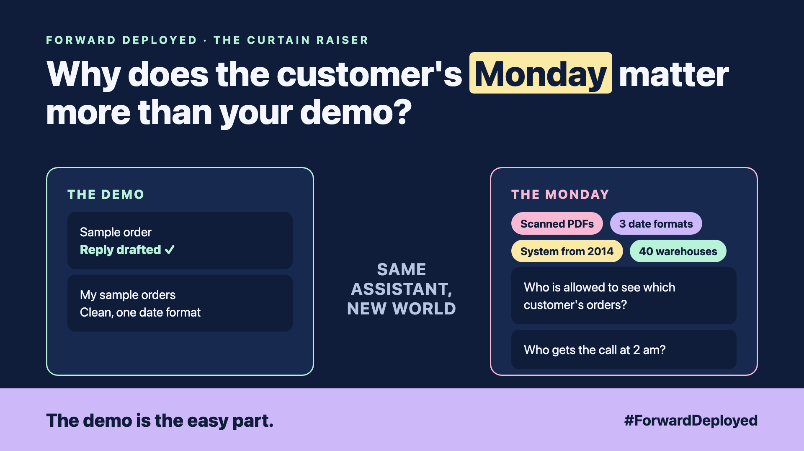

# 1. Why Does the Customer's Monday Matter More Than Your Demo? | The FDE Job



*Forward Deployed series: the curtain raiser*

"Can it run at all 40 warehouses by Monday?"

That was the question from a distributor's operations head. I had just shown an assistant that read a customer's email, found the order, and drafted the reply. It looked brilliant on my laptop, with my sample orders.

Monday was not my sample. Their orders came as scanned PDFs, in three date formats, from a warehouse system last updated in 2014. The assistant worked on the happy path. Their real week had no happy path.

The demo is the easy part. The hard part is making the software work in someone else's world, with their data, their rules and their people. The engineer who does that job is called a Forward Deployed Engineer, or FDE.

## Read these first

This series sits on top of earlier series. You don't need to read them all, but these five give you the ground to stand on. For each one, the series comes first, then the article to read, then why it matters. Read them in this order:

1. **Series: #JustAddRAG**
   Article: [Why does "Just add RAG" sound like 2 weeks but take 6 months?](https://www.linkedin.com/pulse/why-does-just-add-rag-sound-like-2-weeks-take-6-months-arpit-jain-l4kkf/)
   Why it matters: the demo is never the whole job.

2. **Series: #BeyondJustRAG**
   Article: [Your AI Can Answer. Now It Has to Act.](https://www.linkedin.com/pulse/1-your-ai-can-answer-now-has-act-from-answers-actions-arpit-jain-po6lf/)
   Why it matters: an assistant that acts needs more care than one that only answers.

3. **Series: Just put the rules in the prompt**
   Article: [Why Did the AI Promise a Full Refund on a Non-Refundable Ticket?](https://www.linkedin.com/pulse/1-why-did-ai-promise-full-refund-non-refundable-ticket-arpit-jain-gxg4f)
   Why it matters: rules belong in code, not in the prompt.

4. **Series: #JustTellItNot**
   Article: [What If a Customer Tries to Trick It?](https://www.linkedin.com/pulse/4-what-customer-tries-trick-red-teaming-arpit-jain-m7l5f)
   Why it matters: a prompt is a request, not a rule, and customers will test it.

5. **Series: Explain It Like Hello World**
   Article: [How Do Embeddings Know "King" Is Close to "Queen"?](https://www.linkedin.com/pulse/12-how-do-embeddings-know-king-close-queen-arpit-jain-a5xuf)
   Why it matters: the one AI idea the retrieval weeks depend on.

Every write-up in this series uses the same order desk. The earlier reads give you the AI background. This series gives you the customer's side of it.

## The mechanic who goes to the farm

A workshop mechanic fixes the tractors that are driven in. A farm mechanic drives out to the field, sees the mud, the broken gate and the old hitch, and fixes the tractor where it really works. An FDE is the farm mechanic for AI.

## Three hats, one person

An FDE usually wears three hats at once:

- **The builder:** writes code that runs in production, not just in a notebook.
- **The translator:** turns "we want faster refunds" into rules a system can follow.
- **The judge:** decides with the customer what to build, what to buy, and what should not exist at all.

## The questions the demo skips

- Which copy of the data is the true one?
- What happens when a scan is blurry?
- Who is allowed to see which customer's orders?
- What does it cost at 40 sites, not one?
- Who gets the call at 2 am when it breaks?

The demo never asks any of these. The customer's Monday will.

## This is a series: here's what's coming

A taste, not the full plan:

- Before you write any code, learn what the customer will measure.
- Why the data is wrong in exactly the places you least expect.
- How to make an assistant point to the customer's own documents, every time.

## Take this to your next kickoff meeting

1. Ask "What does a good Monday look like?" before you ask "Which model?"
2. Invite the person who gets the 2 am call to the meeting.
3. Ask for one sample from the messiest site, not the cleanest one.

A demo proves the idea works once. An FDE makes it work every day, for the people who depend on it.

**Words to know**

- **Forward Deployed Engineer (FDE):** an engineer who works close to the customer, on their data and systems, to get AI into real use.

Next write-up (2): **What Should You Learn From the Customer Before You Build Anything?**

Follow me for the next one. Which of those five questions would your team answer worst today?

---

**Post text (copy and paste):**

```
The demo worked. Then the customer asked: "Can it run at all 40 warehouses by Monday?"

Their orders were scanned PDFs, in three date formats.

The demo is the easy part.

New series, Forward Deployed (#ForwardDeployed): the engineer's job after the demo.

Which question would your customer's Monday ask first?

#AIEngineering #FDE #ForwardDeployed
```

**Series index (post as the first comment, then pin it):**

```
📌 Forward Deployed: series index

1. Why does the customer's Monday matter more than your demo? (you're here)
2. What should you learn from the customer before you build anything? (next)

Parallel track to AI engineering. 20 write-ups in all, all about the customer.
```
