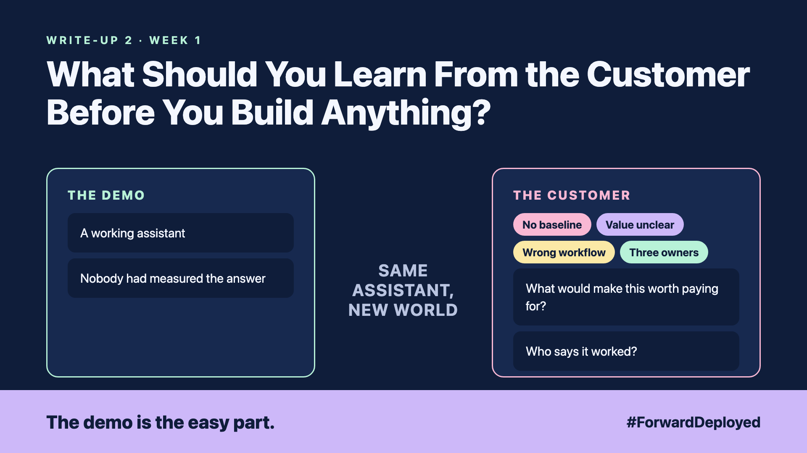

# 2. What Should You Learn From the Customer Before You Build Anything? | Customer discovery



*Forward Deployed series: write-up 2*

"We already built it. Can you just connect it to the order desk?"

We had a working assistant in two weeks. It answered questions about orders beautifully. Then the order desk manager asked one question: "Does this save my team time on Mondays?"

Nobody had measured the answer. Not the time per order today, not the number of replies per day, not the mistakes. We were guessing.

Four things were wrong, and none of them was the code:

- **No baseline:** we had no record of how long a reply takes today.
- **Value unclear:** the assistant answered questions nobody on the desk was asking.
- **Wrong workflow:** the desk starts with the phone, not with email.
- **Three owners:** sales, IT and the desk each thought another team would sign it off.

## Spend a week at the desk first

The fix is not clever. Before any code, sit with the desk for a week. Watch 20 real orders from start to finish. Write down each step, how long it takes, and what goes wrong.

Then pick one workflow to start with. Agree on one number that defines success, such as minutes per order. Measure it today, so you have a baseline to compare against.

## Ask the two questions the demo skips

- **"What would make this worth paying for?"** Get the answer in the customer's words, with a number.
- **"Who says it worked?"** Name one person on the customer's side who signs the result.

A small proof of value comes first. It answers one question for one workflow. A full build can wait until the number moves.

## Take this to your next customer meeting

1. Ask for 20 real examples before you agree on the design.
2. Write the baseline number down before the first line of code.
3. Name the person who signs off the result, in the same meeting.

Next write-up (3): **How Do You Turn the Customer's Rules Into Something You Can Test?**

Follow me for the next one. Which of those two questions would your customer answer first?

---

**Post text (copy and paste):**

```
We built it in two weeks. Then the desk manager asked: "Does this save my team time on Mondays?"

Nobody had measured it.

New FDE write-up (#ForwardDeployed): learn the customer's day first, and set a baseline you can prove.

Which number would your customer's team pick first?

#AIEngineering #FDE #ForwardDeployed
```
