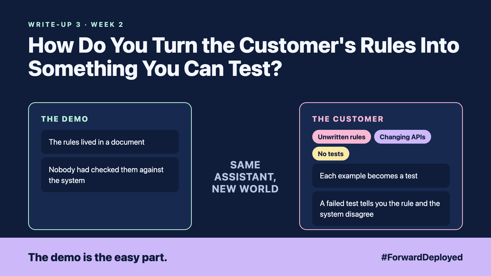

# 3. How Do You Turn the Customer's Rules Into Something You Can Test? | Solution foundation



*Forward Deployed series: write-up 3*

"Refunds are allowed within 30 days, unless it's a sale item. Also, nothing for opened food."

The desk manager said it in one breath. It sounded clear, so we wrote it into the assistant's instructions and called it done.

Two weeks later, a customer got a refund for opened food. The rule was there. The check was not.

Here is what was wrong. The rules lived in a document, and nobody had checked them against the system. Three things were missing:

- **Unwritten rules:** "sale item" meant one thing to sales and another to the warehouse.
- **Changing APIs:** the order system's fields changed names during the pilot, and the assistant kept reading the old ones.
- **No tests:** nobody had a list of cases to run before each change.

## Write the rules as cases

Sit with the desk and turn every rule into examples. A refund on day 29 for a normal item should pass. A refund on day 31 should fail. A refund for opened food should fail, even on day 1.

Each example becomes a test. Run the full list every time the rules, the prompts or the system change. A failed test tells you the rule and the system disagree before the customer does.

## Agree the boundaries of trust

Decide, with the customer, which parts the assistant may read, which it may suggest, and which it may never touch. Write that down as a short table. It is the first document a security reviewer will ask for.

## Take this to your next customer meeting

1. Ask the desk for three real refund cases, including one that was argued over.
2. Turn each rule into an example with a pass or fail answer.
3. Ask who may change a rule, and how the change is tested before it goes live.

Next write-up (4): **Where Does the Customer's Data Hide, and Which Copy Is True?**

Follow me for the next one. Which rule at your customer would fail its first test?

---

**Post text (copy and paste):**

```
"Refunds within 30 days, unless it's a sale item. Nothing for opened food."

The rule was in the prompt. The check was not in the system.

New FDE write-up (#ForwardDeployed): turn the customer's rules into tests before you trust them.

Which rule at your customer would fail its first test?

#AIEngineering #FDE #ForwardDeployed
```
