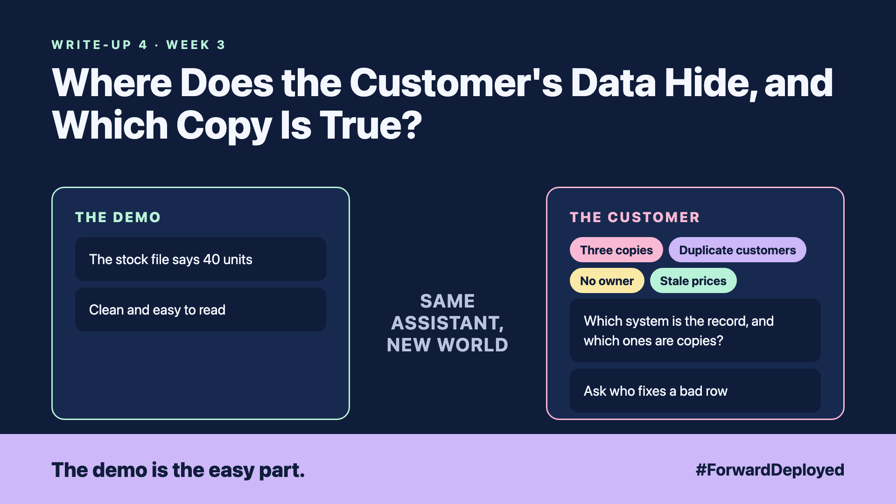

# 4. Where Does the Customer's Data Hide, and Which Copy Is True? | Data estate



*Forward Deployed series: write-up 4*

"The stock file says 40 units. The warehouse says 12. Which one do I trust?"

The order desk asked us that on day three. We had been using the stock file because it was clean and easy to read. It was also a copy, made on Friday.

The customer's data was spread across four places, and each one looked right on its own:

- **Three copies:** the stock file, the warehouse system and the sales sheet all held stock numbers.
- **Duplicate customers:** the same buyer appeared under three spellings.
- **No owner:** nobody in the company was responsible for the price list.
- **Stale prices:** the price list was updated monthly, but orders came in daily.

## Find the record of truth first

For each fact the assistant needs, ask one question: "Which system is the record, and which ones are copies?" The record is the one the business trusts when two systems disagree. Write the answer next to each fact.

Then ask who fixes a bad row. If the answer is "nobody", the assistant will still answer, and it will be wrong with confidence.

## Keep the copies honest

Copies will exist, and that is fine. What matters is that the assistant shows where each answer came from and when that copy was last updated. A stock answer that says "from Friday's file" is safer than one that just says "40 units".

Match duplicates with the customer's own rules, not with a guess. Start with exact matches on tax number or email, and review the rest by hand.

## Take this to your next customer meeting

1. Draw the four or five places the key facts live, and mark the record for each.
2. Name the person who fixes a bad row, and how fast.
3. Ask how old each copy can be before the answer is no longer safe to give.

Next write-up (5): **What Happens When Two of the Customer's Systems Disagree?**

Follow me for the next one. Which copy of your customer's data is the one nobody trusts?

---

**Post text (copy and paste):**

```
"The stock file says 40 units. The warehouse says 12. Which one do I trust?"

The desk asked on day three. We had been using a copy from Friday.

New FDE write-up (#ForwardDeployed): where the customer's data hides, and which copy is true.

Which copy at your customer does nobody trust?

#AIEngineering #FDE #ForwardDeployed
```
