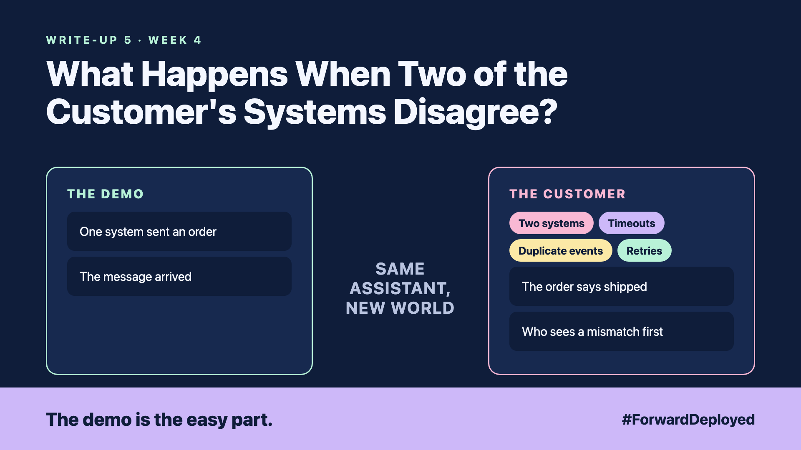

# 5. What Happens When Two of the Customer's Systems Disagree? | Integrations



*Forward Deployed series: write-up 5*

"The order says shipped. The warehouse says still picking."

The assistant read the order system and told a customer the parcel was on its way. The warehouse system had not yet been updated. The customer called the desk, and the desk did not know which system to believe.

Here is what the integration looked like on paper: one system sent an order, the other received it, and the message arrived. In real life, four things went wrong:

- **Two systems:** the order system and the warehouse system each stored the status, and they did not update together.
- **Timeouts:** the warehouse system was slow on Monday mornings, and our call gave up before it answered.
- **Duplicate events:** when a call timed out, we sent it again, and the warehouse received the order twice.
- **Retries:** retrying was the right idea, but nobody had decided how many times, or how long to wait.

## A retry must not create a second order

The rule that fixes most of this is simple. Every request carries a unique key. If the same key arrives twice, the second request returns the first answer and does nothing else. This is called idempotency. It lets you retry safely.

Set a limit on retries, with a short wait between them. After the limit, stop and put the order in a queue for a person to check. A stuck order is better than a double one.

## Show the mismatch, do not hide it

When two systems disagree, the assistant should say so. "The order system says shipped, the warehouse says picking, last checked at 9:40" is an answer the desk can act on. A confident wrong status is not.

## Take this to your next customer meeting

1. Ask what happens today when a call times out, and who notices.
2. Agree the retry limit and the wait between tries, in writing.
3. Ask who sees a mismatch first, and what that person does next.

Next write-up (6): **How Do You Let a Model Act in the Customer's Systems Without Breaking Their Records?**

Follow me for the next one. Which two systems at your customer disagree most often?

---

**Post text (copy and paste):**

```
"The order says shipped. The warehouse says still picking."

A timeout plus a retry sent the same order twice.

New FDE write-up (#ForwardDeployed): when systems disagree, a retry must be safe.

Which two systems at your customer disagree most often?

#AIEngineering #FDE #ForwardDeployed
```
