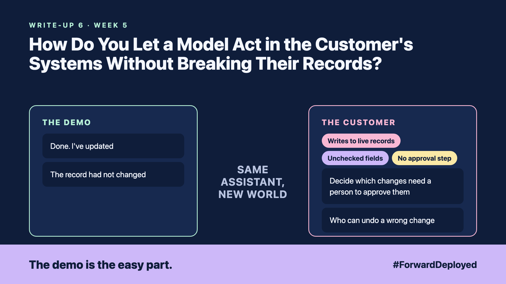

# 6. How Do You Let a Model Act in the Customer's Systems Without Breaking Their Records? | Safe tool use



*Forward Deployed series: write-up 6*

"Done. I've updated the delivery address for order 4471."

The assistant said it. The record had not changed. The model had written the words "updated the address" but had never called the system that holds the address.

That is the first trap. A model can sound like it acted when it did not. The second trap is worse: when it does call the system, it may fill in a field it was not sure about, and nobody checks it.

- **Chat says: done:** the reply claims an action that never happened.
- **Writes to live records:** the assistant can change a customer's address directly.
- **Unchecked fields:** a guessed postcode is saved as if the customer had typed it.
- **No approval step:** nobody reviews a change before it goes live.

## Let the model ask, and the code act

Give the model a short list of named actions, such as "look up order", "draft a reply" and "propose an address change". Each action has a fixed set of fields. The model must fill them in the format the code expects.

The code checks every field before anything is saved. A postcode must match a real format. An address change is written to a pending list, not to the live record. A person or a rule approves it.

## Reply from the record, not from memory

After any action, the assistant reports what the system returned, not what it intended. "Pending approval, reference 88213" is true. "Updated" is only true after the record says so.

## Take this to your next customer meeting

1. List every action the assistant may take, and which ones change money or addresses.
2. Decide which changes need a person to approve them.
3. Ask who can undo a wrong change, and how long it takes.

Next write-up (7): **How Do You Write Prompts the Customer's Security Team Will Sign Off?**

Follow me for the next one. Which action at your customer should never happen without a yes?

---

**Post text (copy and paste):**

```
"Done. I've updated the delivery address for order 4471."

The record had not changed. The assistant said it anyway.

New FDE write-up (#ForwardDeployed): let the model ask, let the code act, and approve the changes that matter.

Which action at your customer should never happen without a yes?

#AIEngineering #FDE #ForwardDeployed
```
