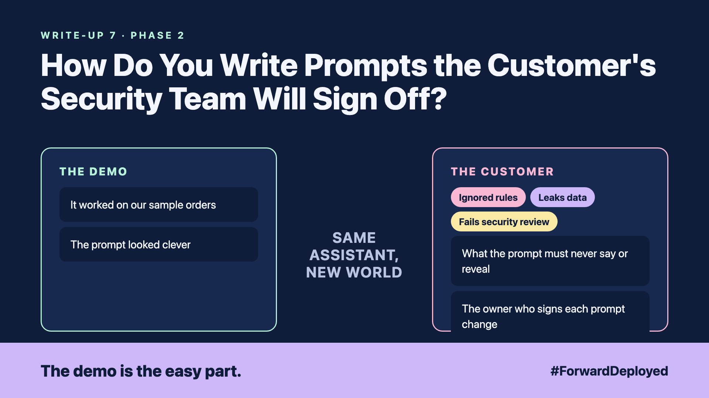

# 7. How Do You Write Prompts the Customer's Security Team Will Sign Off? | Prompt design



*Forward Deployed series: write-up 7*

"Works great in the demo. Now send the prompt to security."

The prompt was one page of clever instructions. It worked on our sample orders. The security team read it and asked three questions we could not answer quickly.

The prompt looked clever. That was the problem. Three things were wrong with it:

- **Ignored rules:** the prompt said "never share prices with customers", but a long order note pushed the rule out of the model's focus.
- **Leaks data:** the prompt included a sample customer record, and the model repeated it.
- **Fails security review:** nobody could say what the prompt was allowed to do, or who approved it.

## Write the prompt as a role, a task and a context

A reviewable prompt states three things in plain words. The role says who the assistant is for. The task says what it must do, in one sentence. The context says what it may use, and nothing else. Each part can be read by a non-engineer.

Keep the rules in code where you can. A prompt that says "do not refund over the limit" is a request. A check in code that blocks the refund is a rule.

## Keep a prompt library, with an owner

Store each prompt in version control, with a name, an owner and a date. Every change goes through a short review. The security team reads the diff, not the whole prompt again.

Test each prompt against the same set of cases from write-up 3. A prompt that passes the demo and fails the test set goes back for another round.

## Take this to your next customer meeting

1. Ask the security team what the prompt must never say or reveal, and write it down.
2. Move every hard rule out of the prompt and into a check in code.
3. Name the owner who signs each prompt change.

Next write-up (8): **How Do You Make Answers Point to the Customer's Own Documents?**

Follow me for the next one. Which rule in your customer's prompt is only a request?

---

**Post text (copy and paste):**

```
"Works great in the demo. Now send the prompt to security."

A prompt that says "never share prices" is a request. A check in code is a rule.

New FDE write-up (#ForwardDeployed): prompts a security team can review and sign off.

Which rule in your customer's prompt is only a request?

#AIEngineering #FDE #ForwardDeployed
```
