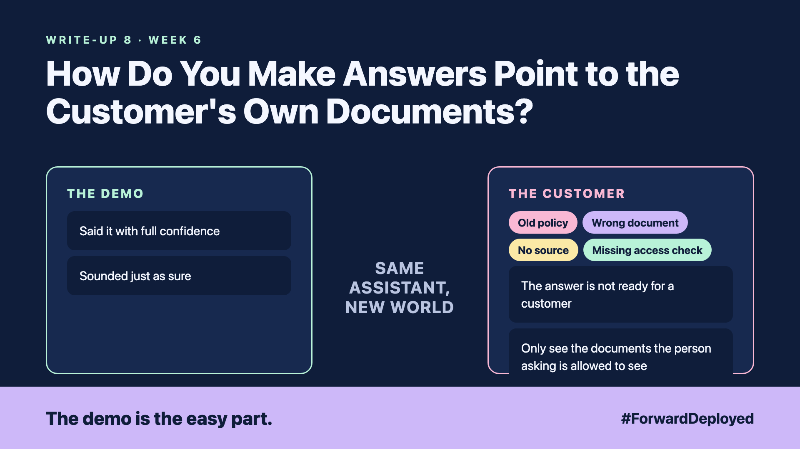

# 8. How Do You Make Answers Point to the Customer's Own Documents? | Grounding



*Forward Deployed series: write-up 8*

"Customers can return opened items within 30 days."

The assistant said it with full confidence. The policy had changed in March. The assistant had read last year's policy, the one saved in an old folder, and it sounded just as sure.

The customer's answers came from the wrong place, and nothing on the screen showed it. Four things went wrong:

- **Old policy:** the assistant read a copy that had been replaced.
- **Wrong document:** a similar page about a different product matched the question better.
- **No source:** the answer had no link to the document it came from.
- **Missing access check:** a trainee could read a manager's pricing notes through the same search.

## Every answer names its source

The most useful change is also the simplest. Each answer shows the document, the section and the date it was last updated. If the desk cannot click through to the source, the answer is not ready for a customer.

Search for the answer in more than one way. Combine keyword search with meaning search, and rank the best matches. When the top documents disagree, say so, and show both.

## Filter by who is asking

Access must be checked before the search, not after the answer is written. The assistant should only see the documents the person asking is allowed to see. Test this with a trainee account and a manager account, using the same question.

## Say "I don't know" when the source is missing

If no document answers the question, the assistant says so, and passes the question to a person. A confident guess is the most expensive answer in this system.

## Take this to your next customer meeting

1. Ask which document is the current policy, and who updates it.
2. Ask the customer to test the same question with two different user accounts.
3. Agree that an answer without a source is not shown to a customer.

Next write-up (9): **Fine-Tune, Retrieve or Prompt: Which Fits the Customer's Problem?**

Follow me for the next one. Which answer at your customer would you need to trace back to its source today?

---

**Post text (copy and paste):**

```
"Customers can return opened items within 30 days."

Said with full confidence. The policy had changed in March.

New FDE write-up (#ForwardDeployed): name the source for every answer, and check access before the search.

Which answer at your customer would you need to trace back today?

#AIEngineering #FDE #ForwardDeployed
```
