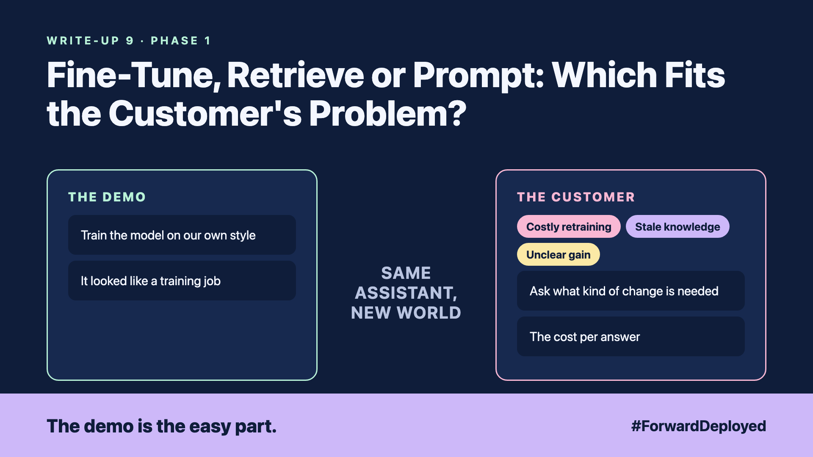

# 9. Fine-Tune, Retrieve or Prompt: Which Fits the Customer's Problem? | Model choices



*Forward Deployed series: write-up 9*

"Can we just train the model on our own style? Then it will sound like us."

The customer's marketing lead had seen a demo of a model that wrote in a particular tone. They wanted the same tone for order replies. It looked like a training job, and training sounds like the serious option.

Before buying anything, it helps to name what the customer really needs. Three options look similar in a meeting, but they solve different problems:

- **Model learns our style:** good for tone and format, weak for facts that change.
- **Costly retraining:** every policy change means a new training run and new tests.
- **Stale knowledge:** a trained model knows what it was trained on, and nothing newer.
- **Unclear gain:** nobody had measured how much better the trained version was.

## Ask what kind of change is needed

- **New knowledge:** the assistant needs the current policy and stock. Retrieval fits this, because you can update a document in minutes.
- **New behaviour:** the assistant needs the right format, tone or steps every time. Clear prompts, and sometimes fine-tuning, fit this.
- **Both:** most real projects need retrieval for facts and a prompt for behaviour, and fine-tuning only if the first two fall short.

Fine-tuning usually means training a small add-on to an existing model, rather than retraining the whole model. It is a real option, but it is slower to change and harder to review.

## Measure before you pay

Run the same 30 real questions three ways: a clear prompt, a prompt with retrieval, and the fine-tuned version. Compare the answers and the cost per answer. Let the numbers decide.

## Take this to your next customer meeting

1. Ask whether the answer changes every month or every year.
2. Ask who will update the knowledge, and how fast.
3. Agree the 30 test questions before any option is built.

Next write-up (10): **What Happens When an Agent Stops Halfway Through the Customer's Job?**

Follow me for the next one. Which of your customer's answers changes faster than their training data?

---

**Post text (copy and paste):**

```
"Can we just train the model on our style?"

Facts that change belong in retrieval. Format and tone belong in the prompt.

New FDE write-up (#ForwardDeployed): fine-tune, retrieve or prompt, and measure before you pay.

Which answer at your customer changes faster than its training data?

#AIEngineering #FDE #ForwardDeployed
```
