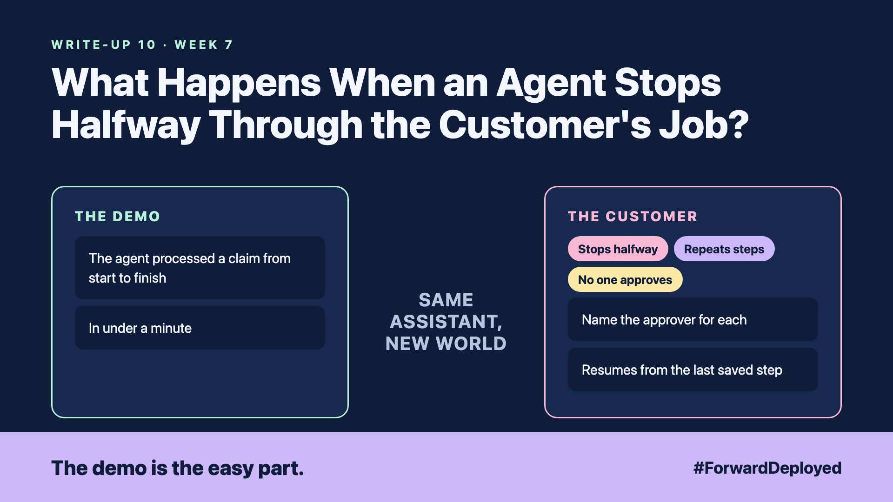

# 10. What Happens When an Agent Stops Halfway Through the Customer's Job? | Durable agents



*Forward Deployed series: write-up 10*

"The claim was filed. The receipts were not attached. Is the job done?"

In the demo, the agent processed a claim from start to finish in under a minute. In the customer's world, the claim system timed out at receipt number nine. The agent stopped. The claim sat in a half-done state for two days.

Nobody knew which steps had finished. The desk could not tell whether to resend, skip or start again.

- **Stops halfway:** a timeout or crash ended the job, and nothing saved its place.
- **Repeats steps:** when someone restarted it, the agent filed the claim again.
- **No one approves:** a refund step ran without a person seeing it.

## Save the job's place after every step

A durable job writes down its state after each step: what is done, what is pending, and what the result was. If the job stops, it resumes from the last saved step, not from the start.

Each step also has a clear end. A step either completes, fails with a reason, or waits for a person. Nothing stays in a silent in-between state.

## Put a person where money or records change

Some steps need a yes. A refund, a change of address or a new order should wait for an approver. The job pauses at that step, shows the approver what it intends to do, and continues only after the answer.

The desk needs controls too: pause, resume and cancel, visible on one screen. An operator who cannot stop a job is not in control of it.

## Take this to your next customer meeting

1. Ask what the desk does today when a job stops halfway, and who finds out.
2. List the steps that change money or records, and name the approver for each.
3. Agree the pause, resume and cancel buttons before the first live job.

Next write-up (11): **Who Decides When Several Agents Work on the Customer's Case?**

Follow me for the next one. What happens today to the last job your customer's team left half-done?

---

**Post text (copy and paste):**

```
"The claim was filed. The receipts were not attached."

A timeout stopped the agent at receipt nine. Nobody knew which steps had finished.

New FDE write-up (#ForwardDeployed): save the job's place after every step.

What happens today to the last job your customer left half-done?

#AIEngineering #FDE #ForwardDeployed
```
