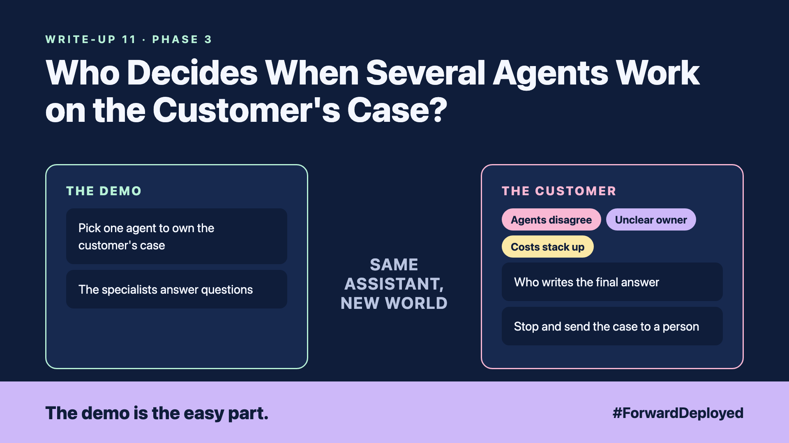

# 11. Who Decides When Several Agents Work on the Customer's Case? | Agent teams



*Forward Deployed series: write-up 11*

"We have three agents on this case. Which one owns the refund?"

The customer had split a complaint into three parts: the order, the payment and the delivery. Each part had its own agent. Each agent did its job well. Nobody owned the complaint as a whole.

The payment agent issued a refund. The delivery agent, working from older data, asked for the refund to be reversed. The order agent wrote a note that agreed with neither.

- **Agents disagree:** each agent had a correct view of its own part, and the views clashed.
- **Unclear owner:** no agent was responsible for the final answer to the customer.
- **Costs stack up:** each agent called the model again and again, and the bill grew with every loop.

## One agent owns the case

Pick one agent to own the customer's case. It keeps the plan, decides which specialist to call, and writes the final answer. The specialists answer questions. They do not decide the case.

This is called orchestration. It is simple to explain, and it makes the owner obvious to the customer's team.

## Give each agent a limit

Set a step limit for the whole case, and a stop rule for loops. If the same question comes back twice, stop and send the case to a person. Set a budget per case, so one stuck case cannot empty the monthly limit.

Autonomy is the other choice: agents decide among themselves. It can work for research tasks. For customer records, the owner model is safer, because every decision has one name against it.

## Take this to your next customer meeting

1. Ask who owns a customer's complaint today, from start to finish.
2. Agree the one agent, or person, who writes the final answer.
3. Set the step limit and the budget per case before the first run.

Next write-up (12): **How Do You Test the Customer's Assistant Before a Stranger Does?**

Follow me for the next one. Which part of your customer's case has no clear owner today?

---

**Post text (copy and paste):**

```
"We have three agents on this case. Which one owns the refund?"

The payment agent refunded. The delivery agent asked for it back.

New FDE write-up (#ForwardDeployed): one owner, a step limit and a budget per case.

Which part of your customer's case has no owner today?

#AIEngineering #FDE #ForwardDeployed
```
