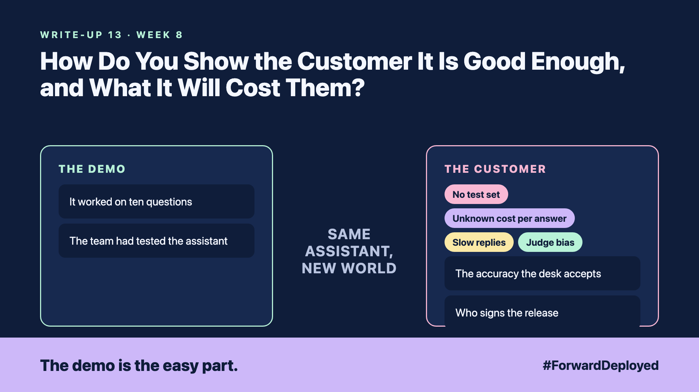

# 13. How Do You Show the Customer It Is Good Enough, and What It Will Cost Them? | Evaluation and cost



*Forward Deployed series: write-up 13*

"It worked on ten questions. Can we go live on Monday?"

The team had tested the assistant on ten questions, and it answered all ten well. The desk manager asked how it would do on the other 900 questions customers ask each week. Nobody knew.

The team also did not know what each answer cost. The first monthly bill was three times what they had guessed.

- **No test set:** ten questions tell you almost nothing about 900 real ones.
- **Unknown cost per answer:** nobody had counted the calls behind each reply.
- **Slow replies:** answers took eight seconds, and customers left the chat before reading them.
- **Judge bias:** the AI that graded the answers had been trained to like long replies, so it scored long replies higher.

## Build a test set from real questions

Collect 200 real questions from the desk's inbox, with the answers the desk accepted. Split them into easy, normal and hard. Keep part of the set hidden from the team while they tune the assistant, so the score is honest.

Check the AI grader against a person. Have the desk grade 50 answers by hand, and compare the scores. If the grader disagrees often, fix the grader before you trust its scores.

## Count the cost per answer

Write down the cost of one answer, including every model call and every search. Multiply by the monthly volume. Compare the result with the value from write-up 2, the minutes saved per order.

Set the release gates before the test: the accuracy the desk accepts, the highest cost per answer, and the longest wait. A release that misses one gate waits.

## Take this to your next customer meeting

1. Ask for 200 real questions and the answers the desk accepted.
2. Agree the three gates: accuracy, cost per answer and reply time.
3. Name the person who signs the release, based on the scores.

Next write-up (14): **Who at the Customer May Do What, and Can You Prove It Later?**

Follow me for the next one. What is the cost of one answer at your customer, today?

---

**Post text (copy and paste):**

```
"It worked on ten questions. Can we go live on Monday?"

The desk has 900 questions a week. Nobody had tested 900.

New FDE write-up (#ForwardDeployed): build the test set from real questions, then set the gates.

What is the cost of one answer at your customer today?

#AIEngineering #FDE #ForwardDeployed
```
