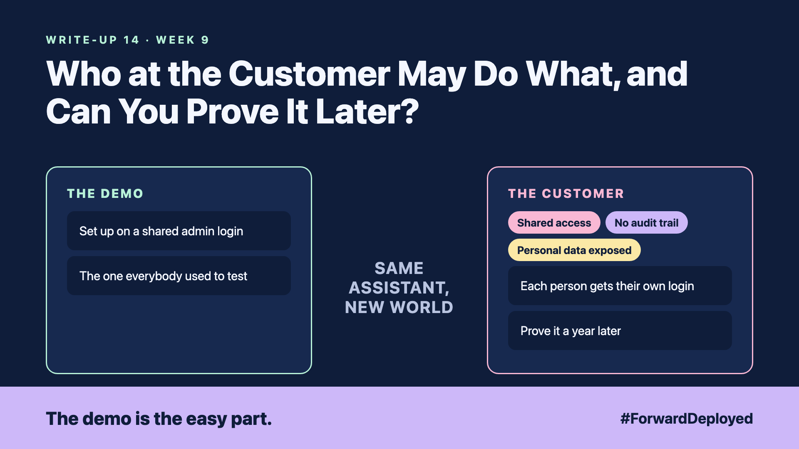

# 14. Who at the Customer May Do What, and Can You Prove It Later? | Identity and governance



*Forward Deployed series: write-up 14*

"Who changed the refund limit last Tuesday?"

Nobody could answer. The assistant had been set up on a shared admin login during the pilot, the one everybody used to test. Three months later, the customer's auditor asked for the record of every change, and the only name on the log was the shared login.

The customer had built a system that could issue refunds, and could not say who had approved them.

- **Shared access:** one login, many people, no way to tell them apart.
- **No audit trail:** changes happened, but nothing recorded who made them or why.
- **Personal data exposed:** customer addresses and phone numbers were visible to every user, not only to the desk.

## Every person and every action has a name

Each person gets their own login, tied to the customer's identity system. Each role gets only the permissions the job needs. A trainee can read orders. Only a manager can change a limit.

Every change is logged with the person, the time, the old value and the new value. The log is stored where the people being logged cannot edit it.

## Keep personal data where it belongs

Show customer details only to the staff who need them for the task. Mask the rest, such as showing the last four digits of a phone number. The assistant should not repeat personal data in its answers unless the person asking is allowed to see it.

## Prove it a year later

Ask the customer's compliance team what evidence they need, and in what form. Usually it is a list of who did what, when, and who approved it. Test the log by pulling a sample of changes and checking that every one has an owner.

## Take this to your next customer meeting

1. Ask who is allowed to change a refund limit, and who approves that change.
2. Remove any shared login before the system goes live.
3. Ask the auditor for one sample question they would ask in a year, and check that the log can answer it.

Next write-up (15): **Where Should It Run in the Customer's Cloud, and Who Restarts It at 2 am?**

Follow me for the next one. Who at your customer could show you the log of the last change to a refund limit?

---

**Post text (copy and paste):**

```
"Who changed the refund limit last Tuesday?"

Nobody could say. The pilot used one shared admin login.

New FDE write-up (#ForwardDeployed): one login per person, and every change logged.

Who at your customer could show that log today?

#AIEngineering #FDE #ForwardDeployed
```
