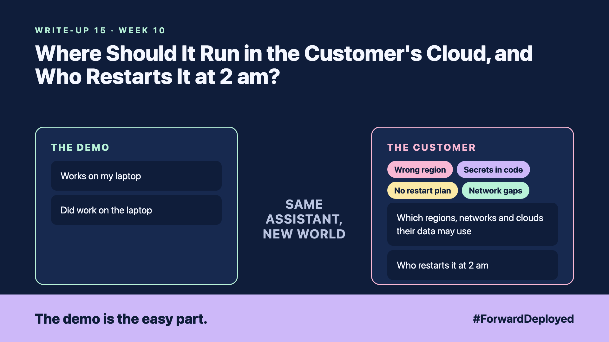

# 15. Where Should It Run in the Customer's Cloud, and Who Restarts It at 2 am? | Deployment and runtime



*Forward Deployed series: write-up 15*

"It works on my laptop. Can we just put it on a server?"

It did work on the laptop, and the demo ran from there for a month. The first real deployment went to a server in the wrong region, where the customer's data was not allowed to go. The second failed because the API key was written into the code, which was then shared in a repository.

The third failed at 2 am, when the server ran out of memory. Nobody on the customer's team knew how to restart it.

- **Wrong region:** the data travelled outside the country it was allowed to stay in.
- **Secrets in code:** keys were saved in the source files, where anyone with access could copy them.
- **No restart plan:** the only person who knew the restart steps was asleep in another time zone.
- **Network gaps:** the assistant could not reach the warehouse system from the new server.

## Choose the place with the customer's rules

Ask the customer which regions, networks and clouds their data may use. Write the answer down before you choose any service. Then deploy only inside that boundary.

## Keep secrets out of the code

Keys and passwords live in a secrets store, managed by the customer's team. The code asks for them when it starts. A key that appears in a file is treated as leaked, and it is replaced.

## Write the restart steps for a person at 2 am

The restart plan is a short page: what the alert looks like, the three commands to run, who to call, and what not to touch. Test it once, in daylight, with a person who did not write it.

## Take this to your next customer meeting

1. Ask which regions and networks the customer's data may use.
2. Move every key into the customer's secrets store before go-live.
3. Ask who gets the 2 am alert, and test the restart steps with them.

Next write-up (16): **How Does the Customer Know It Is Working on a Tuesday Afternoon?**

Follow me for the next one. If your assistant went down tonight, who at your customer would find out first?

---

**Post text (copy and paste):**

```
"It works on my laptop."

The first server was in the wrong region. The second had the API key in the code.

New FDE write-up (#ForwardDeployed): deploy inside the customer's rules, and write the restart steps.

If your assistant went down tonight, who would find out first?

#AIEngineering #FDE #ForwardDeployed
```
