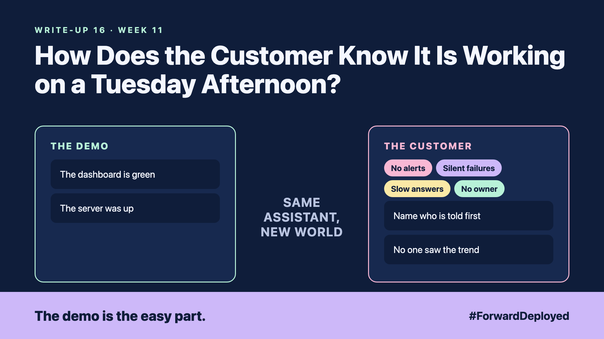

# 16. How Does the Customer Know It Is Working on a Tuesday Afternoon? | Observability



*Forward Deployed series: write-up 16*

"The dashboard is green. So why are customers complaining?"

The dashboard showed the server was up, the response code was 200 and the queue was empty. The assistant was returning answers in under a second. The answers were wrong. A stale price list had been loaded on Monday night, and nothing on the dashboard measured whether the prices were right.

Green meant the system was running. It did not mean the system was right.

- **No alerts:** nobody had set a threshold for wrong prices or failed refunds.
- **Silent failures:** the assistant returned a polite apology instead of an error, so no error was logged.
- **Slow answers:** replies crept from one second to eight over three weeks, and no one saw the trend.
- **No owner:** the alert, if it had fired, would have gone to a shared inbox nobody read.

## Measure what the customer cares about

Pick three signals the desk would notice: the share of answers the desk accepts, the time to the first reply, and the number of refunds sent to a person. Show these next to the uptime number, not below it.

Set an alert for each, with a threshold the desk agreed. An alert that fires every hour is ignored, so start with loose thresholds and tighten them.

## Name who is told first

Every alert has a named person, a backup and a time to respond. The person is told by a channel someone actually reads. Test the alert on a Tuesday afternoon, not in the middle of an incident.

## Take this to your next customer meeting

1. Ask what the desk would notice first if the answers went wrong.
2. Agree three signals and one threshold for each.
3. Name the person who is told first, and the backup.

Next write-up (17): **How Do You Run a Pilot With Real Users Without Betting the Customer's Business?**

Follow me for the next one. What would your customer notice first if the answers went wrong this afternoon?

---

**Post text (copy and paste):**

```
"The dashboard is green. So why are customers complaining?"

The server was up. The answers were wrong. Nothing measured the prices.

New FDE write-up (#ForwardDeployed): measure what the customer notices, and name who is told first.

What would your customer notice first?

#AIEngineering #FDE #ForwardDeployed
```
