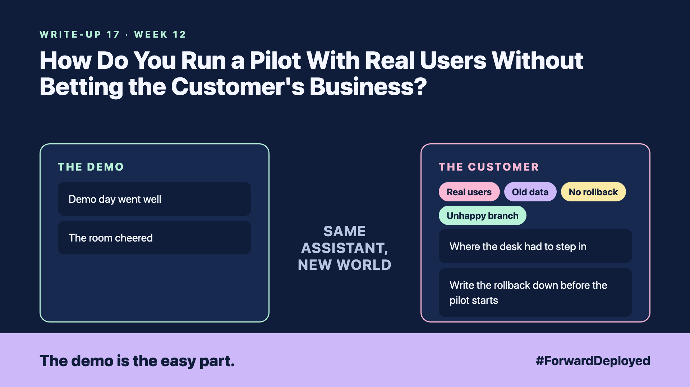

# 17. How Do You Run a Pilot With Real Users Without Betting the Customer's Business? | Pilot and cutover



*Forward Deployed series: write-up 17*

"The demo day went well. Switch everyone over on Monday."

The demo had gone well. The room cheered. The desk manager asked for everyone to switch on Monday, and the sales director agreed in the meeting.

On Monday, the assistant met real users for the first time. The old order data had gaps. One branch used a different unit for stock. The angry customers went straight to a person, and the desk had no fast way to turn the assistant off.

- **Real users:** people used the assistant in ways no test had tried.
- **Old data:** three years of records had missing fields the demo never touched.
- **No rollback:** there was no way to go back to the old process in under an hour.
- **Unhappy branch:** one branch refused to use it, and nobody had asked them why.

## Pilot with a small group, and a way back

Choose one branch and ten users. Run the old process alongside the new one for two weeks. Compare the answers, and count the cases where the desk had to step in.

Write the rollback down before the pilot starts. It should say who presses the switch, how long it takes, and what the desk does for the next hour.

## Move the customer's data with a check

Before cutover, copy the data and compare totals, not just a sample. Agree what counts as a match. Keep the old system read-only for a month, so you can compare if something looks wrong.

## Take this to your next customer meeting

1. Pick one branch and ten users for the pilot, and ask why the others are not in it yet.
2. Agree the rollback steps and the person who can press the switch.
3. Set the cutover date only after the pilot numbers match the agreed gates.

Next write-up (18): **What Does the Customer's Team Need to Run This Without You?**

Follow me for the next one. Which branch at your customer would you ask first, and why?

---

**Post text (copy and paste):**

```
"The demo day went well. Switch everyone over on Monday."

On Monday, real users found the gaps. One branch used a different stock unit.

New FDE write-up (#ForwardDeployed): pilot small, write the rollback first.

Which branch at your customer would you ask first, and why?

#AIEngineering #FDE #ForwardDeployed
```
