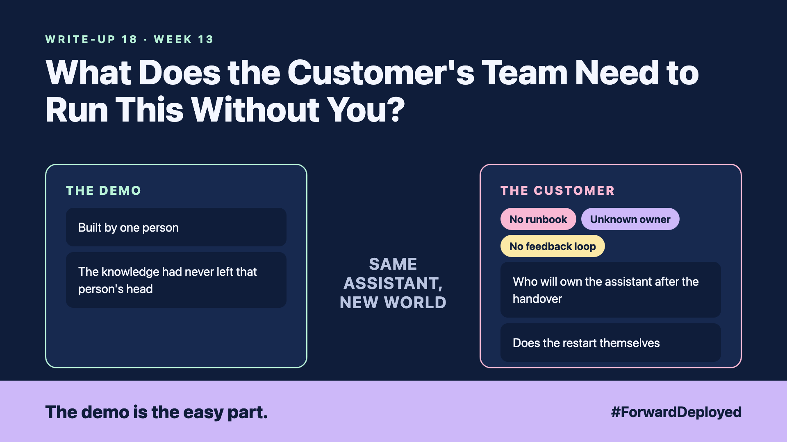

# 18. What Does the Customer's Team Need to Run This Without You? | Handover



*Forward Deployed series: write-up 18*

"What happens when you leave on Friday?"

The engineer who built the assistant was the only one who knew how it worked. Their last day was in two weeks. The desk asked a simple question, and the honest answer was "nothing, until we call them back."

The system had been built well. It had been built by one person, and the knowledge had never left that person's head.

- **No runbook:** the steps for daily checks, updates and restarts existed only in chat messages.
- **Unknown owner:** the customer had no named person who would decide when the assistant changed.
- **No feedback loop:** desk complaints went to the engineer, not to a list the customer's team could read.

## Hand over the knowledge, not just the code

A handover has four parts: a short runbook, a named owner, a list of known issues, and a training session with the people who will run it. Each part is written for the customer's team, not for engineers.

The runbook answers five questions: what to check each morning, how to restart, how to add a rule, how to report a wrong answer, and who to call. It fits on a few pages.

## Let the desk own the feedback

Set up one shared list where the desk logs every wrong answer, with the question and the reply. The owner reviews the list every week and decides what to change. The feedback then goes to the team that runs the system, not to a person who has left.

## Take this to your next customer meeting

1. Ask who will own the assistant after the handover, by name.
2. Agree the runbook's five questions and who writes each answer.
3. Run one training session where the customer's team does the restart themselves.

Next write-up (19): **Which AI Bet Should the Customer Make First, and How Do You Score the Risk?**

Follow me for the next one. Who at your customer would own this system on the first day after you leave?

---

**Post text (copy and paste):**

```
"What happens when you leave on Friday?"

The honest answer was "nothing, until we call them back."

Only one person knew how it worked.

New FDE write-up (#ForwardDeployed): hand over a runbook and a named owner.

Who at your customer would own this system on your last day?

#AIEngineering #FDE #ForwardDeployed
```
