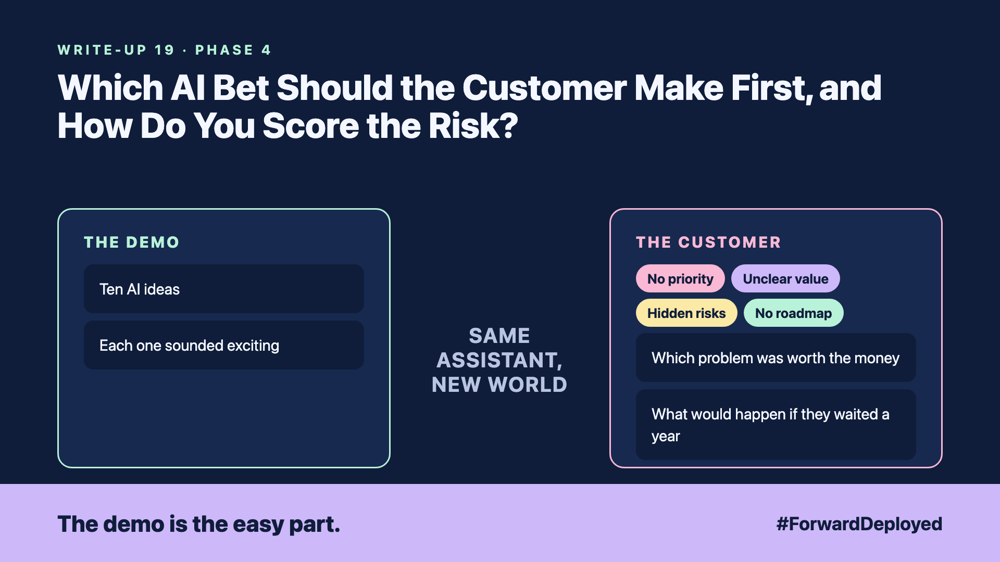

# 19. Which AI Bet Should the Customer Make First, and How Do You Score the Risk? | Strategy and portfolio



*Forward Deployed series: write-up 19*

"We have ten AI ideas. Which one do we start with?"

The customer's leadership team had a list of ten ideas from the last workshop. Each one sounded exciting. Each one had a senior sponsor. Nobody had written down which problem was worth the money, or what would happen if they waited a year.

Three months later, they had started two projects and finished neither. Both had been chosen because they were the loudest, not because they mattered most.

- **No priority:** every idea was equal on the list, so none was first.
- **Unclear value:** nobody had put a number on what each idea would save or earn.
- **Hidden risks:** data access, customer trust and legal review were not on the list at all.
- **No roadmap:** the ideas had no order, owners or dates.

## Start from the customer's problem

For each idea, write the problem in one sentence in the desk's words. Then write the value as a number the customer already tracks, such as minutes per order or refunds per month. An idea without a number stays on the list until someone finds one.

## Score the risk in the open

Score each idea on two things: how big the impact is if it works, and how likely it is to fail. Multiply them, and sort the list. Write the reason for each score next to it, so the team can challenge it.

Add the risks that are easy to forget: which data the idea needs, who must approve it, and what a wrong answer would cost the customer.

## Pick one bet and a date

Choose one idea for the next quarter, with a named owner, a baseline number and a review date. The other ideas wait in order. A roadmap with one bet is more useful than a roadmap with ten.

## Take this to your next customer meeting

1. Ask for the value of each idea as a number the customer already tracks.
2. Score each idea on impact and likelihood, and write the reason for each score.
3. Choose one bet, name its owner, and set the review date.

Next write-up (20): **Is It Ready for the Customer, or Only for the Demo?**

Follow me for the next one. Which of your customer's ten ideas would you put first, and what would it cost to wait?

---

**Post text (copy and paste):**

```
"We have ten AI ideas. Which one do we start with?"

Each one sounded exciting. Nobody had put a number on any of them.

New FDE write-up (#ForwardDeployed): one customer number per idea, then one bet.

Which idea would you put first, and what does waiting cost?

#AIEngineering #FDE #ForwardDeployed
```
