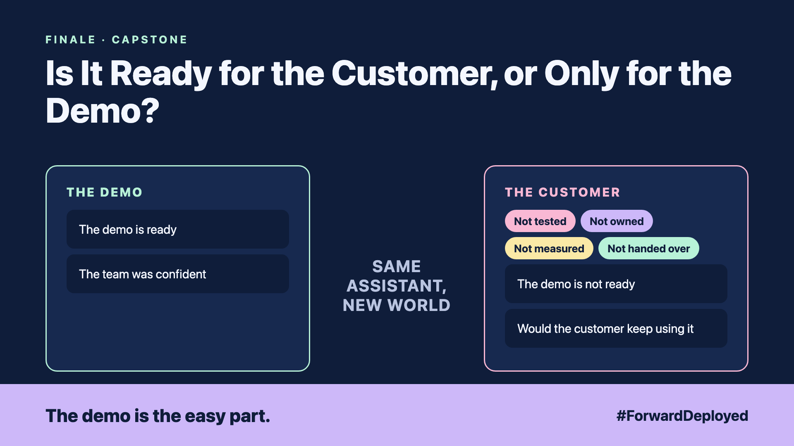

# 20. Is It Ready for the Customer, or Only for the Demo? | The finale



*Forward Deployed series: the finale*

"The demo is ready. Can we announce it on Monday?"

The team was confident. The demo had impressed the sponsor, and the sponsor wanted the announcement in the next all-hands. The desk had not yet seen the system with its own orders for a full week.

Before saying yes, we went back through the whole series with the customer. Here is what the checklist found:

- **Not tested:** the test set from write-up 13 had 40 questions, not 200.
- **Not owned:** no named person would decide when the assistant changes.
- **Not measured:** the baseline from write-up 2 had never been recorded.
- **Not handed over:** the runbook from write-up 18 was still in chat messages.

## Ask the customer five questions

1. **Does it solve the problem in the desk's words?** Show the baseline and the new number, side by side.
2. **Is every action checked?** Show the approval steps from write-ups 6 and 10.
3. **Can we see what it did?** Show the log and the source for a sample answer, from write-ups 8 and 14.
4. **Who gets the call at 2 am?** Show the restart steps and the alert, from write-ups 15 and 16.
5. **Would the customer keep using it?** Show the pilot numbers from write-up 17, and the wrong answers the desk logged.

If the answer to any question is "not yet", the demo is not ready. That is useful news, not a failure.

## The capstone readout

Present the whole engagement in one meeting: the discovery, the working system, the evaluation, the operations and the measured value. Keep it to what the customer's team can check for themselves.

## Take this to your next customer meeting

1. Go through the five questions with the customer's team, not just the sponsor.
2. Write down every "not yet", with an owner and a date.
3. Agree the date of the next review, before anyone announces anything.

This is the end of the first pass through the series. The next topic is set by your customer's next question.

Would your customer keep using it on Tuesday, after the demo is forgotten?

---

**Post text (copy and paste):**

```
"The demo is ready. Can we announce it on Monday?"

Before saying yes, we asked five questions.

Is it tested? Owned? Measured? Handed over? Would the customer keep using it?

New FDE finale (#ForwardDeployed): the readiness checklist for the customer.

Would your customer keep using it after the demo?

#AIEngineering #FDE #ForwardDeployed
```
